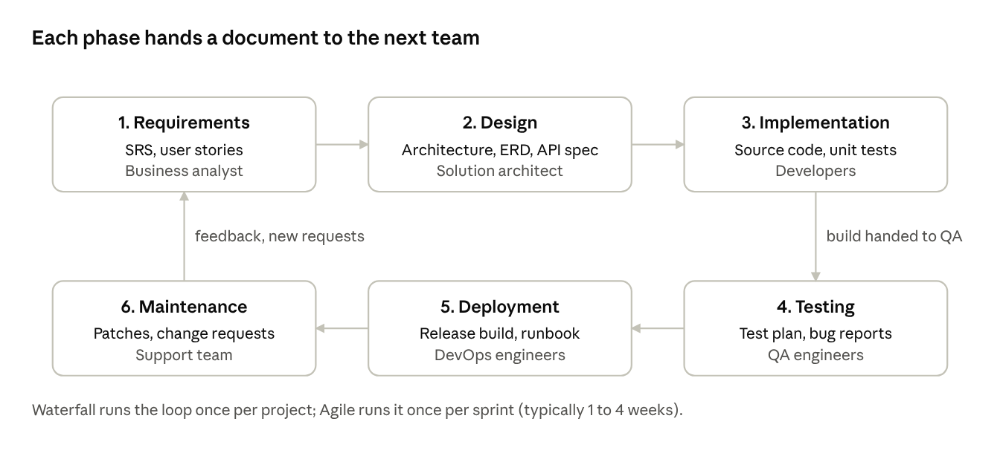
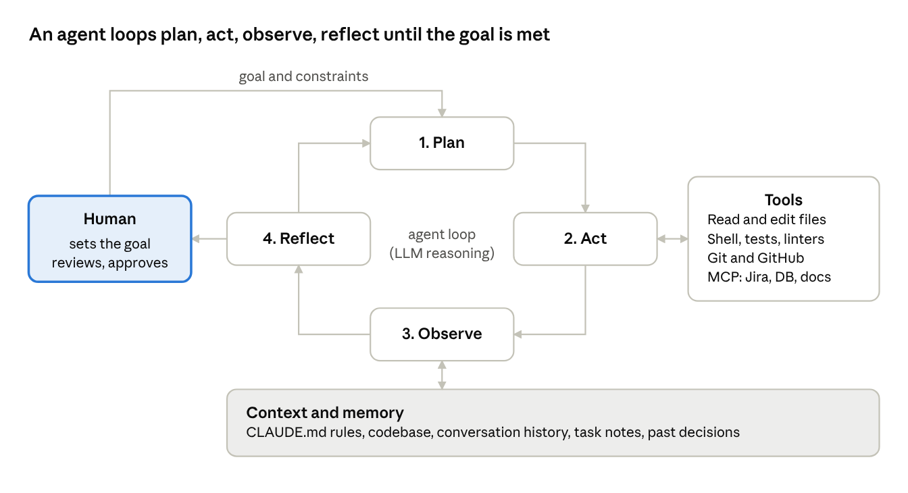
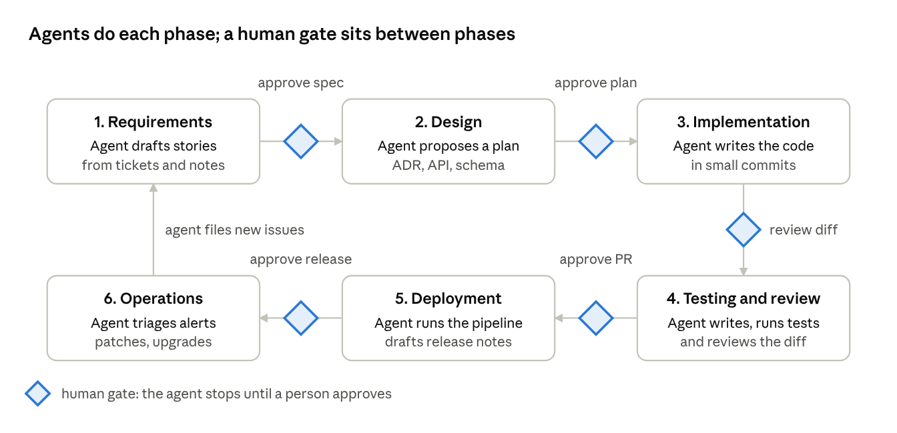
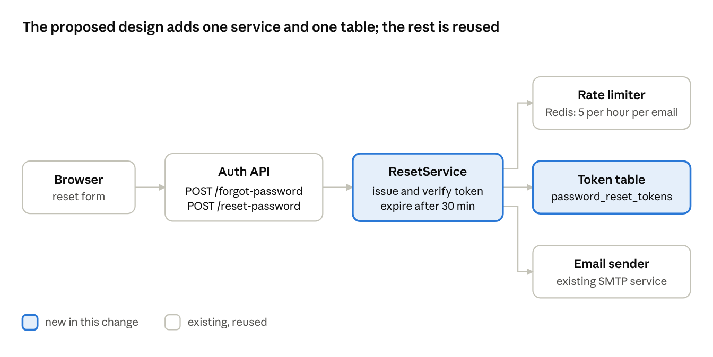
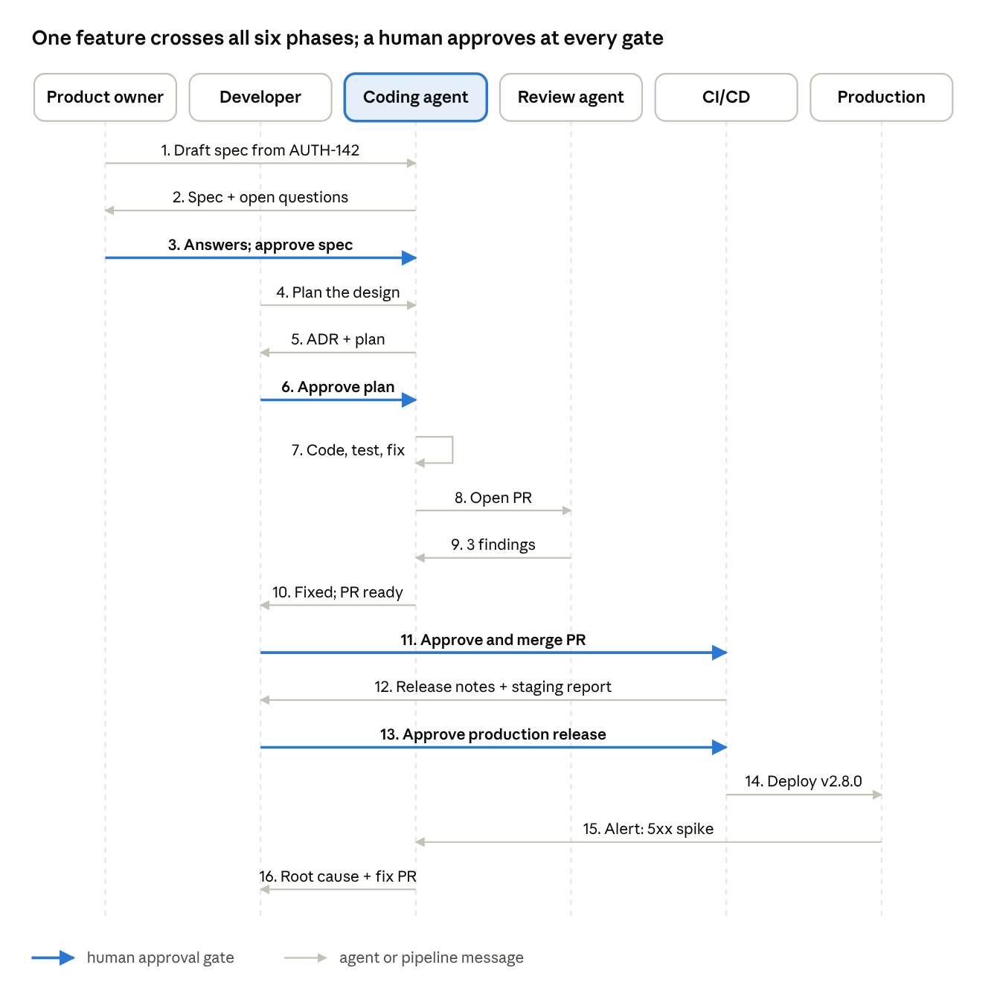

<div align="center">
    
    <h1>Tech Stacks</h1>
    <strong>A tech stack is the combination of technologies a company uses to build and run an application or project.</strong>
</div>

# From Traditional SDLC to Agentic AI SDLC — A Teaching Guide

Oct 17, 2026 · @gitmehedi

## Contents

- [How to use this guide](#how-to-use-this-guide)
- [1. Traditional SDLC recap](#1-traditional-sdlc-recap)
- [2. What makes an AI agent](#2-what-makes-an-ai-agent)
- [3. The mapping: traditional phase to agentic phase](#3-the-mapping-traditional-phase-to-agentic-phase)
- [4. Phase 1 — Requirements](#4-phase-1--requirements)
- [5. Phase 2 — Design](#5-phase-2--design)
- [6. Phase 3 — Implementation](#6-phase-3--implementation)
- [7. Phase 4 — Testing and review](#7-phase-4--testing-and-review)
- [8. Phase 5 — Deployment](#8-phase-5--deployment)
- [9. Phase 6 — Operations and maintenance](#9-phase-6--operations-and-maintenance)
- [10. End-to-end worked example](#10-end-to-end-worked-example)
- [11. Roles, governance and guardrails](#11-roles-governance-and-guardrails)
- [12. Adoption roadmap, exercises and glossary](#12-adoption-roadmap-exercises-and-glossary)

## How to use this guide

Agentic SDLC keeps every phase of the traditional SDLC but changes who does the work: AI agents draft, build, test and operate, while humans set intent, approve at gates and own the outcome. Nothing in the classic lifecycle disappears; each phase gets an agent that executes it and a human checkpoint that governs it.

**Audience.** Developers, tech leads, QA engineers, project managers and students who already know the classic SDLC and want to see how it maps onto AI-agent workflows such as Claude Code.

**After this guide you will be able to:**

1. Name the six SDLC phases and the artifact each one produces.
2. Explain the agent loop (plan, act, observe, reflect) and why tools and context matter.
3. Map each traditional phase to its agentic equivalent, including the human gate.
4. Walk one feature end to end through an agentic pipeline.
5. Set guardrails: permissions, review gates and metrics.

**The one-sentence idea.** Traditional SDLC is a pipeline of *people handing documents to people*; agentic SDLC is a pipeline of *agents handing verified artifacts to humans for approval*.

**Running example.** Every phase uses the same feature so you can follow it through: *add a "Forgot password" flow to a web app* (email link, token expiry after 30 minutes, rate limit of 5 requests per hour).

## 1. Traditional SDLC recap

The Software Development Life Cycle is six phases, each owned by a specialist role and closed by a document that the next role reads. Its strength is predictability; its cost is the wait at every handoff.



Read it clockwise: every arrow is a handoff between people, and every box ends with a document someone must read before the next box can start.

| Phase | Question it answers | Main artifact | Owner |
| --- | --- | --- | --- |
| 1. Requirements | What must the system do? | SRS, user stories, acceptance criteria | Business analyst, product owner |
| 2. Design | How will it be built? | Architecture diagram, ERD, API contract | Solution architect |
| 3. Implementation | Build it | Source code, unit tests | Developers |
| 4. Testing | Does it work as specified? | Test plan, test cases, bug reports | QA engineers |
| 5. Deployment | Get it to users safely | Release build, runbook, change ticket | DevOps / release manager |
| 6. Maintenance | Keep it running and improving | Patches, incident reports, change requests | Support / SRE |

**Waterfall vs Agile.** Waterfall runs the six phases once, in order, with a sign-off between each. Agile (Scrum, Kanban) runs a small slice of all six every sprint. Agentic SDLC works with both, but it fits Agile best because agents shrink each loop from weeks to hours.

**Where traditional SDLC hurts** (and where agents help most):

- **Handoff latency** — work waits in queues between roles.
- **Documentation drift** — the SRS and design docs stop matching the code.
- **Late testing** — bugs found in phase 4 are expensive to fix in phase 3.
- **Repetitive toil** — boilerplate code, test scaffolding, dependency upgrades, log reading.
- **Knowledge silos** — only one person understands a module.

## 2. What makes an AI agent

An AI agent is a language model running in a loop with tools: it plans a step, takes it, looks at the result, and decides what to do next until the goal is met. A chatbot answers once; an agent keeps working and checks its own output.



The human starts the loop with a goal and gets the result back for approval; in between, the agent cycles through the four steps, using tools to touch the real system and context to stay on track.

### Core vocabulary

| Term | Meaning | Example in Claude Code |
| --- | --- | --- |
| Model (LLM) | The reasoning engine that reads context and decides the next action | Claude Opus, Sonnet, Haiku |
| Agent | Model + loop + tools + a goal | Claude Code working on "add forgot-password" |
| Tool | A function the agent can call to act on the world | Read, Edit, Bash, Grep, WebFetch |
| Context | Everything the model can see right now | Open files, command output, conversation |
| Memory | Knowledge kept across sessions | `CLAUDE.md`, memory files, docs in the repo |
| MCP server | A plug-in that exposes an external system as tools | Jira, GitHub, Postgres, Slack connectors |
| Subagent | A helper agent with its own context for a sub-task | An Explore agent that searches the codebase |
| Human-in-the-loop | A point where the agent must stop for human approval | Permission prompt, plan approval, PR review |

### The loop in action — a mini trace

Goal given by the developer: *"The test `test_reset_token_expires` is failing. Fix it."*

1. **Plan** — "Run the test to see the error, read the token code, find the cause."
2. **Act** — runs `pytest tests/test_reset.py -k expires`.
3. **Observe** — output says the token is still valid after 31 minutes.
4. **Reflect** — "Expiry compares in seconds but the constant is in minutes." Loops back to Plan.
5. **Plan / Act** — edits `TOKEN_TTL = 30 * 60`, reruns the test.
6. **Observe** — test passes; full suite passes.
7. **Reflect** — goal met; reports the diff and the reason to the human.

> Teacher's note: the *Observe* step is what separates an agent from autocomplete. Because it runs the test and reads the result, it can correct itself without a human spotting the bug.

## 3. The mapping: traditional phase to agentic phase

Every traditional phase survives; the doer becomes an agent and the specialist becomes the approver. The handoff document becomes a machine-checkable artifact (a spec file, a plan, a passing test suite) that the next agent can read directly.



Same six phases, same loop. The difference is the diamonds: each is a deliberate stop where a human reads what the agent produced and says yes, no, or change this.

| Phase | Traditional: who does it, how | Agentic: what the agent does | Human gate | Artifact handed on |
| --- | --- | --- | --- | --- |
| 1. Requirements | BA interviews users, writes SRS over weeks | Reads tickets, meeting notes, existing code; drafts user stories + acceptance criteria; lists open questions | Product owner approves the spec | `docs/specs/<feature>.md` |
| 2. Design | Architect draws diagrams, writes design doc | Explores the codebase, proposes a plan (files to change, API, schema, risks) in plan mode | Architect / tech lead approves the plan | `docs/adr/NNN-<feature>.md`, plan |
| 3. Implementation | Developers write code by hand | Edits files, runs build and linters, commits in small steps; subagents work in parallel | Developer reviews the diff | Feature branch, commits |
| 4. Testing | QA writes test cases, runs them manually | Writes unit/integration/E2E tests, runs them, fixes failures; a reviewer agent checks the diff | Human approves the pull request | Green PR with review comments |
| 5. Deployment | DevOps runs release checklist | Runs CI/CD, checks staging, writes release notes and rollback steps | Release manager approves production | Tagged release, changelog |
| 6. Maintenance | Support reads logs, files bugs | Triages alerts, finds root cause, opens fix PRs, upgrades dependencies on a schedule | On-call engineer approves fix | Incident report, fix PR |

**Three shifts to remember:**

1. **From writing to reviewing.** Humans spend less time producing artifacts and more time judging them.
2. **From documents to executable specs.** Acceptance criteria become tests; design decisions become files the agent reads every session.
3. **From long phases to tight loops.** A phase that took a week becomes a loop of minutes, so you can run the whole SDLC many times per day for small features.

## 4. Phase 1 — Requirements

In agentic SDLC the agent turns raw input (tickets, call notes, the existing code) into a structured spec with testable acceptance criteria, and the product owner edits and approves it. The agent is good at completeness and consistency; the human owns priority and business intent.

|  | Traditional | Agentic |
| --- | --- | --- |
| Input | Stakeholder interviews | Same, plus tickets, transcripts, existing code via MCP |
| Work | BA writes the SRS by hand | Agent drafts stories, edge cases, open questions |
| Output | Word document | Markdown spec in the repo, versioned with the code |
| Time | Days to weeks | Minutes to draft, an hour to review |
| Gate | Sign-off meeting | PO approves the spec PR |

### Example

**Prompt the PO gives the agent:**

```text
Read Jira ticket AUTH-142 and the notes in docs/meetings/2026-10-14.md.
Look at how login works today in src/auth/.
Write docs/specs/forgot-password.md with:
- user stories in "As a / I want / So that" form
- acceptance criteria in Given/When/Then
- non-functional requirements (security, limits)
- open questions you could not answer from the sources
Do not write any code.
```

**What the agent produces (excerpt):**

```markdown
## User story US-1
As a registered user, I want to reset my password by email,
so that I can log in again without contacting support.

## Acceptance criteria
- AC-1 Given a registered email, when I submit the form,
  then I receive a reset link within 1 minute.
- AC-2 Given a link older than 30 minutes, when I open it,
  then I see "Link expired" and can request a new one.
- AC-3 Given 5 requests in one hour from one email,
  when I submit a 6th, then I see "Too many requests".
- AC-4 Given an unknown email, when I submit the form,
  then I see the same success message (no account enumeration).

## Open questions
- Q1 Should existing sessions be logged out after a reset?
- Q2 Is SMS reset in scope? Ticket mentions it, notes do not.
```

**Human gate.** The PO answers Q1 ("yes, log out all sessions") and Q2 ("out of scope"), the agent updates the spec, and the PO merges it. AC-4 is a good example of value the agent adds: a security edge case the ticket never mentioned.

**Teaching points**

- Ask for *open questions* explicitly; it stops the agent from inventing answers.
- Keep the spec in the repo so later agents (design, code, test) read the same source of truth.
- Numbered acceptance criteria (AC-1, AC-2…) become test names in Phase 4 — that is traceability for free.

## 5. Phase 2 — Design

The agent reads the approved spec and the real codebase, then proposes a plan: which files change, which components are new, the API contract, the data model and the risks. The architect approves or redirects the plan before any code is written — the cheapest place to catch a wrong design.

In Claude Code this is **plan mode** (Shift+Tab to toggle): the agent can read and explore but cannot edit files until you approve the plan.

### Example

**Prompt:**

```text
/plan
Read docs/specs/forgot-password.md (approved).
Explore src/auth/ and src/db/ to see existing patterns.
Propose a design: components, API endpoints, DB schema,
files to create or change, risks, and a test strategy.
Reuse existing services where possible. Write it as an ADR.
```

**The design the agent proposes:**



Only two boxes are new; the agent found an existing rate limiter and email sender by exploring the code, which a human designer under time pressure might have rebuilt.

**Excerpt of the ADR it writes** (`docs/adr/014-password-reset.md`):

```markdown
## Decision
Add ResetService and table password_reset_tokens
(id, user_id, token_hash, expires_at, used_at).
Store only a SHA-256 hash of the token, never the raw token.

## Files
- new:    src/auth/reset_service.py
- new:    migrations/0042_password_reset_tokens.sql
- change: src/auth/routes.py   (2 endpoints)
- change: src/auth/session.py  (revoke all sessions, per Q1)

## Risks
- Token leakage in logs -> mask token in request logging
- Clock skew between app servers -> compare in DB time
```

**Human gate.** The tech lead reads the plan and pushes back on one point: "use the existing `jobs` queue to send email asynchronously." The agent revises the plan; the lead approves.

**Teaching points**

- Always design in plan mode first for anything larger than a one-file change.
- Ask the agent to *reuse existing patterns* — it will search for them.
- Commit the ADR: it becomes the context future agents read when they touch this code.

## 6. Phase 3 — Implementation

The coding agent executes the approved plan: it edits files, runs the build and linters after each change, and commits in small steps. The developer's job shifts from typing code to steering, reading diffs and answering the agent's questions.

### The project rulebook: CLAUDE.md

In traditional teams, coding standards live in a wiki nobody reads. In agentic teams they live in `CLAUDE.md` at the repo root, and the agent reads it at the start of every session.

```markdown
# CLAUDE.md
## Stack
Python 3.12, FastAPI, PostgreSQL 16, pytest

## Commands
- Run tests: make test
- Lint:      make lint   (ruff + mypy, must pass before commit)
- Migrate:   make migrate

## Rules
- Follow the service pattern in src/auth/login_service.py
- Never log tokens, passwords or emails in plain text
- Every endpoint needs a test in tests/api/
- Commit messages: [ADD] / [FIX] / [MOD] prefix
```

### Example session

```text
> Implement docs/adr/014-password-reset.md step by step.
  Commit after each step. Stop and ask if anything in the
  ADR is ambiguous.
```

What the agent does, in order:

1. Writes `migrations/0042_password_reset_tokens.sql`, runs `make migrate` — succeeds. Commits `[ADD] reset tokens table`.
2. Writes `reset_service.py` following the login service pattern; `make lint` fails on a type error; fixes it; commits.
3. Adds the two endpoints in `routes.py`; enqueues email via the `jobs` queue (the tech lead's design change).
4. **Stops and asks:** "The ADR says revoke all sessions. Should that include the session that just reset the password?" Developer: "Yes, force a fresh login."
5. Updates `session.py`, runs the full test suite, reports a summary of the diff.

### Scaling up with subagents and parallel work

| Technique | What it does | When to use it |
| --- | --- | --- |
| Subagents | A helper agent with fresh context does one sub-task and returns a summary | Searching a large codebase, researching a library |
| Git worktrees | Several agents work on separate copies of the repo | Independent features in parallel |
| Headless mode (`claude -p`) | Runs the agent non-interactively from a script or CI | Batch jobs, pipelines |
| Hooks | Run your own script before/after a tool call | Auto-format after every edit, block edits to `migrations/` already applied |
| Permission modes | Control what the agent may do without asking | Strict for production repos, relaxed in a sandbox |

**Human gate.** The developer reviews the full diff (`git diff main`) before opening the PR. The rule: *you are responsible for every line the agent wrote, as if you wrote it.*

**Teaching points**

- Small commits make agent work easy to review and easy to revert.
- Tell the agent *when to stop and ask* — otherwise it will guess.
- Put repeated corrections into `CLAUDE.md` so you never have to say them twice.

## 7. Phase 4 — Testing and review

Testing moves from a separate late phase to a loop inside implementation: the agent turns each acceptance criterion into a test, runs it, and fixes failures before a human sees the code. A second, independent agent then reviews the diff, and a human makes the final call on the pull request.

|  | Traditional | Agentic |
| --- | --- | --- |
| Test design | QA writes cases from the SRS | Agent writes one test per AC, plus edge cases |
| Execution | Manual runs, nightly suites | Agent runs tests after every change |
| Bug loop | QA files bug, dev fixes days later | Agent sees failure, fixes in seconds |
| Code review | Senior dev reviews every line | Reviewer agent first, human reviews what matters |
| Gate | QA sign-off | Human approves the PR |

### Example: acceptance criteria become tests

**Prompt:** `Write pytest tests for every AC in docs/specs/forgot-password.md. Name each test after its AC. Run them and fix any failures in the code, not the tests.`

```python
def test_ac1_registered_email_gets_link(client, user, outbox):
    r = client.post("/forgot-password", json={"email": user.email})
    assert r.status_code == 202
    assert len(outbox) == 1

def test_ac2_link_expires_after_30_minutes(client, user, freezer):
    token = issue_token(user)
    freezer.tick(minutes=31)
    r = client.post("/reset-password", json={"token": token, "password": "N3w!pass"})
    assert r.json()["error"] == "Link expired"

def test_ac3_sixth_request_in_an_hour_is_blocked(client, user):
    for _ in range(5):
        client.post("/forgot-password", json={"email": user.email})
    r = client.post("/forgot-password", json={"email": user.email})
    assert r.status_code == 429

def test_ac4_unknown_email_gets_same_message(client):
    r = client.post("/forgot-password", json={"email": "nobody@example.com"})
    assert r.status_code == 202   # no account enumeration
```

First run: AC-2 fails (the minutes-vs-seconds bug from the agent-loop trace in section 2). The agent fixes the code, reruns, all green.

> Watch for this anti-pattern: an agent that "fixes" a failing test by weakening the assertion. The instruction *fix the code, not the tests* prevents it, and the human reviewer should check test diffs carefully.

### Example: agent code review

In Claude Code, `/code-review` (or `/security-review`) reviews the branch. Typical findings for this feature:

| Severity | Finding | Fix |
| --- | --- | --- |
| High | Token compared with `==` — timing attack possible | Use `hmac.compare_digest` |
| Medium | Token not marked used after a successful reset; link can be replayed | Set `used_at`, reject if set |
| Low | Rate-limit key uses raw email; `A@x.com` and `a@x.com` counted separately | Lower-case the email |

**Human gate.** The reviewer reads the PR description the agent wrote, checks the test names against the ACs, spot-checks the security fixes, and approves.

**Teaching points**

- Test names that cite AC numbers give you a requirement-to-test trace matrix automatically.
- Use a *different* agent session (or subagent) for review than the one that wrote the code — fresh context catches more.
- Humans review the *risky* parts deeply (auth, money, data deletion) and skim the boilerplate.

## 8. Phase 5 — Deployment

Deployment stays deterministic: the CI/CD pipeline, not the agent, pushes code to production. Agents sit *inside* the pipeline to review, summarise, write release notes and check staging, and a human still presses the button for production.

|  | Traditional | Agentic |
| --- | --- | --- |
| Release notes | Written by hand from commit list | Agent drafts from PRs, specs and ADRs |
| Pre-release check | Manual checklist | Agent runs smoke tests on staging, reads logs, reports |
| Rollback plan | Runbook in wiki, often stale | Agent writes rollback steps specific to this change (e.g. down-migration) |
| Production push | Ops engineer runs the deploy | Pipeline deploys after human approval |

### Example: an agent in the CI pipeline

An illustrative GitHub Actions workflow. The agent reviews every PR in headless mode; production deploy is gated by a protected environment that needs a human approver.

```yaml
name: ci
on:
  pull_request:
  push:
    branches: [main]

jobs:
  test:
    runs-on: ubuntu-latest
    steps:
      - uses: actions/checkout@v4
      - run: make lint test

  agent-review:                      # agent reviews the PR
    if: github.event_name == 'pull_request'
    needs: test
    runs-on: ubuntu-latest
    steps:
      - uses: actions/checkout@v4
      - uses: anthropics/claude-code-action@v1
        with:
          anthropic_api_key: ${{ secrets.ANTHROPIC_API_KEY }}
          prompt: |
            Review this PR against CLAUDE.md and the linked spec.
            Flag security issues first. Post findings as comments.

  release-notes:                     # agent drafts notes on main
    if: github.ref == 'refs/heads/main'
    needs: test
    runs-on: ubuntu-latest
    steps:
      - uses: actions/checkout@v4
      - run: |
          claude -p "Write release notes for commits since the last tag. \
          Group by feature, link specs, list migrations and rollback steps." \
          > RELEASE_NOTES.md

  deploy-prod:
    needs: release-notes
    environment: production          # human approval required here
    runs-on: ubuntu-latest
    steps:
      - run: ./scripts/deploy.sh
```

**Release notes the agent drafts (excerpt):**

```markdown
## v2.8.0
### Added
- Forgot-password flow (spec: docs/specs/forgot-password.md, ADR-014)
### Database
- Migration 0042 adds password_reset_tokens. Rollback: make migrate-down 0041
### Watch after deploy
- 429 rate on /forgot-password; reset-email queue depth
```

**Human gate.** The release manager reads the notes and the staging report, then approves the `production` environment in GitHub.

**Teaching points**

- Give pipeline agents *read and comment* rights, not deploy rights.
- Store the API key as a secret; scope agent tokens to the minimum.
- The agent's "watch after deploy" list feeds straight into Phase 6.

## 9. Phase 6 — Operations and maintenance

After release, agents do the investigation and toil: they triage alerts, trace a symptom to a root cause, open a fix PR, and run scheduled chores like dependency upgrades. The on-call engineer decides and approves; the agent's output loops back to Phase 1 as new, well-documented issues.

| Task | Traditional | Agentic |
| --- | --- | --- |
| Incident triage | On-call reads dashboards and logs at 3 a.m. | Agent pulls logs/metrics via MCP, posts a summary with likely cause |
| Bug fixing | Ticket waits in the backlog | Agent reproduces, writes a failing test, opens a fix PR |
| Dependency upgrades | Quarterly, painful | Scheduled agent upgrades weekly, runs tests, opens PR |
| Documentation | Drifts out of date | Agent updates docs in the same PR as the code |
| Tech debt | "Someday" list | Agent takes small refactors in the background |

### Example: an incident

Alert at 09:12: *5xx rate on `/reset-password` above 2%.*

**Prompt from the on-call engineer:**

```text
Investigate the 5xx spike on /reset-password since 09:00.
Use the logs MCP and the last 3 deploys. Do not change anything
in production. Give me cause, evidence, and a proposed fix.
```

**Agent's report (excerpt):**

```text
Cause:    Email job fails for addresses with a '+' (user+tag@x.com).
          The jobs queue URL-encodes '+' as a space -> user not found -> 500.
Evidence: 214 errors, all with '+' in the email; started with v2.8.0.
Fix:      Encode the payload as JSON instead of a query string.
          Draft PR #318 adds a failing test test_plus_address_email
          and the fix. All tests pass.
Rollback: Not needed; impact limited to '+' addresses (about 3% of users).
```

**Human gate.** The on-call engineer verifies the evidence, approves PR #318, and it ships through the normal pipeline. The agent also files issue AUTH-151: *"Add '+' addresses to the email test fixtures"* — the feedback arrow back to Requirements.

### Example: a scheduled maintenance agent

In Claude Code, `/schedule` creates a cloud agent that runs on a cron schedule:

```text
/schedule every Monday 06:00:
  Upgrade Python dependencies with patch or minor updates.
  Run make test. If green, open a PR titled "[MOD] weekly deps".
  If red, open an issue describing which package broke what.
```

**Teaching points**

- Say *"do not change anything in production"* in incident prompts; give the agent read-only access to prod systems.
- Ask for evidence, not just a conclusion — it makes the agent's claim checkable.
- Every incident should leave behind a test, so the agent cannot regress the same bug.

## 10. End-to-end worked example

Here is the whole forgot-password feature in one picture: one ticket in, one running feature out, with the agent doing the work and a human approval at every gate steering it. In a traditional team this is typically a multi-week effort across four or five people; in an agentic team the same steps can fit into a day or two, with most human time spent on the gates.



Read top to bottom. Bold blue arrows are the human gates; everything else is the agent or the pipeline working. Step 15 is the loop closing: production feeds the next round of requirements.

| Steps | SDLC phase | Agent work | Human decision |
| --- | --- | --- | --- |
| 1–3 | Requirements | Drafts spec, ACs, open questions | PO answers questions, approves spec |
| 4–6 | Design | Explores code, writes ADR and plan | Tech lead changes email to async queue, approves |
| 7 | Implementation | Migration, service, endpoints, small commits | Answers "revoke current session?" |
| 8–11 | Testing and review | Tests per AC; reviewer agent finds 3 issues; fixes | Developer approves and merges PR |
| 12–14 | Deployment | Release notes, staging smoke test, rollback steps | Release manager approves production |
| 15–16 | Operations | Triages 5xx spike, root cause, fix PR, new issue | On-call approves fix |

**Classroom exercise:** cover the right-hand column and ask students where they would put each gate, and what could go wrong if it were removed.

## 11. Roles, governance and guardrails

Agentic SDLC does not remove roles; it moves each role up one level, from producing work to specifying and judging it. Governance is what keeps that safe: clear permissions, mandatory gates, and metrics that measure outcomes rather than lines of code.

### How each role changes

| Role | Traditional focus | Agentic focus |
| --- | --- | --- |
| Product owner / BA | Writing requirements | Giving context, answering agent questions, approving specs |
| Architect / tech lead | Drawing designs | Reviewing agent plans, maintaining `CLAUDE.md` and ADRs |
| Developer | Writing code | Steering agents, reviewing diffs, owning correctness |
| QA engineer | Running test cases | Designing test strategy, auditing agent-written tests, exploratory testing |
| DevOps / SRE | Running deploys, firefighting | Building safe pipelines and agent permissions, approving releases |
| Project manager | Tracking tasks | Tracking gates, throughput and quality metrics |

### Guardrails checklist

- [ ] **Least privilege** — agents get read access by default; write, deploy and production access are explicit and scoped.
- [ ] **Permission rules** — allow safe commands (`make test`), require approval for risky ones (`git push`, `rm`, DB migrations) in `.claude/settings.json`.
- [ ] **Sandbox first** — run autonomous agents in containers or worktrees, never directly on production.
- [ ] **Mandatory human gates** — spec, plan, PR and production release cannot be skipped by an agent.
- [ ] **Secrets hygiene** — no keys in prompts or `CLAUDE.md`; use a secret store.
- [ ] **Audit trail** — every agent change goes through git and a PR; nothing changes outside version control.
- [ ] **Hooks for policy** — e.g. block edits to applied migrations, auto-run the formatter after edits.
- [ ] **Untrusted input** — treat web pages, tickets and logs the agent reads as data, not instructions (prompt-injection risk).

### What to measure

| Metric | Why it matters |
| --- | --- |
| Lead time (ticket to production) | The main promise of agentic SDLC |
| Change failure rate | Speed must not cost quality |
| PR rework rate (human changes after agent PR) | Shows how well agents follow your context |
| Escaped defects per release | Checks that agent-written tests are meaningful |
| Human review time per PR | Shows where gates are slow or too shallow |

### Common anti-patterns

| Anti-pattern | Symptom | Fix |
| --- | --- | --- |
| Rubber-stamp review | PRs approved in seconds | Review checklist; reviewer must cite one thing checked |
| Vibe coding in production | No spec, no plan, straight to code | Require spec + plan gates for non-trivial changes |
| Test weakening | Assertions loosened to make tests pass | "Fix code, not tests"; review test diffs |
| Context starvation | Agent repeats the same mistake | Put the rule in `CLAUDE.md` |
| Giant PRs | 3,000-line agent diffs | Ask for small commits and one PR per story |
| Over-permission | Agent can push to main or touch prod | Least privilege, protected branches |

## 12. Adoption roadmap, exercises and glossary

Adopt agentic SDLC one phase at a time, starting where the risk is lowest and the toil is highest, and move to the next level only when the metrics in section 11 hold steady.

### Adoption roadmap

1. **Level 1 — Assistant.** Developers use an agent for explanations, small edits and tests on their own machine. Add a `CLAUDE.md` to each repo (`/init` generates a first draft).
2. **Level 2 — Pair programmer.** Agents implement whole stories from an approved plan; humans review every diff. Introduce plan mode and permission rules.
3. **Level 3 — Team member.** Agents in CI review every PR and draft release notes; specs and ADRs live in the repo; requirements agents draft stories from tickets.
4. **Level 4 — Autonomous loops.** Scheduled and event-driven agents handle dependency upgrades, alert triage and small bug fixes end to end, stopping only at human gates.

### Classroom exercises

1. **Map it.** Take a feature your team shipped last quarter. List every handoff document. For each, write which agent could have produced it and who would approve it.
2. **Write the spec.** Give an agent a one-line ticket ("users can export invoices as PDF"). Compare its acceptance criteria and open questions with what your team wrote by hand.
3. **Plan mode drill.** Ask the agent for a design in plan mode. Find one thing you would change before approving — then explain why the agent could not have known it.
4. **Write a CLAUDE.md.** Write the 10 most important rules for your codebase. Run the same task with and without the file and compare the diffs.
5. **Break the gate.** In a sandbox, give an agent too much permission and a vague goal. Note what it does. Then add guardrails from section 11 and repeat.
6. **Trace matrix.** For a finished feature, check that every AC number appears in at least one test name. Where it does not, ask the agent to add the missing test.

### Quick self-check

- [ ] I can name the human gate for each of the six phases.
- [ ] I can explain why the Observe step makes an agent self-correcting.
- [ ] I know which artifacts the agent should keep in the repo (spec, ADR, CLAUDE.md, tests).
- [ ] I can list three guardrails I would set before letting an agent into CI.

### Glossary

| Term | Definition |
| --- | --- |
| ADR | Architecture Decision Record: a short file recording one design decision and why |
| Acceptance criteria (AC) | Testable conditions a story must meet, often in Given/When/Then form |
| Agent loop | Plan, act, observe, reflect, repeated until the goal is met |
| CLAUDE.md | Project instruction file Claude Code reads at the start of every session |
| Headless mode | Running the agent without an interactive session (`claude -p`), e.g. in CI |
| Hook | A script that runs automatically before or after an agent tool call |
| Human-in-the-loop (HITL) | A mandatory human approval point in an automated flow |
| MCP | Model Context Protocol: a standard way to connect agents to external tools and data |
| Plan mode | Agent mode that can read and plan but not edit until the plan is approved |
| Prompt injection | Malicious instructions hidden in content the agent reads |
| Subagent | A helper agent with its own context, used for a focused sub-task |
| Worktree | A separate working copy of a git repo, letting agents work in parallel |
