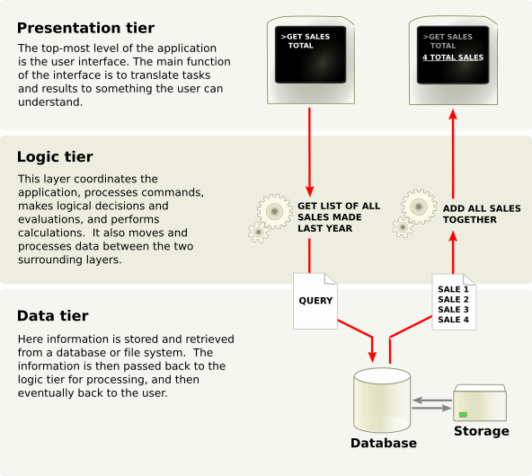

<div align="center">
    <h1>Odoo Developer Tutorials</h1>
    <strong>A tech stack is the combination of technologies a company uses to build and run an application or project.</strong>
</div>

<!-- TOC -->

* [Setup Guide](#setup-guide)
* [Server Framework 101](#server-framework-101)
    * [Chapter 1: Architecture Overview](#chapter-1-architecture-overview)
    * [Chapter 2: A New Application](#chapter-2-a-new-application)
    * [Chapter 3: Models And Basic Fields](#chapter-3-models-and-basic-fields)
    * [Chapter 4: Security - A Brief Introduction](#chapter-4-security---a-brief-introduction)
    * [Chapter 5: Finally, Some UI To Play With](#chapter-5-finally-some-ui-to-play-with)
    * [Chapter 6: Basic Views](#chapter-6-basic-views)
    * [Chapter 7: Relations Between Models](#chapter-7-relations-between-models)
    * [Chapter 8: Computed Fields And Onchanges](#chapter-8-computed-fields-and-onchanges)
    * [Chapter 9: Ready For Some Action?](#chapter-9-ready-for-some-action)
    * [Chapter 10: Constraints](#chapter-10-constraints)
    * [Chapter 11: Add The Sprinkles](#chapter-11-add-the-sprinkles)
    * [Chapter 12: Inheritance](#chapter-12-inheritance)
    * [Chapter 13: Interact With Other Modules](#chapter-13-interact-with-other-modules)
    * [Chapter 14: A Brief History Of QWeb](#chapter-14-a-brief-history-of-qweb)
    * [Chapter 15: The final word](#chapter-15-the-final-word)
* [Discover the Web Framework](#discover-the-web-framework)
* [Master the Web Framework](#master-the-web-framework)
* [Define Module Data](#define-module-data)
* [Restrict Access to Data](#restrict-access-to-data)
* [Safeguard you code with unit tests](#safeguard-you-code-with-unit-tests)
* [Write Importable Modules](#write-importable-modules)
* [Reuse Code with Mixins](#reuse-code-with-mixins)
* [Build PDF Reports](#build-pdf-reports)
* [Build Website Theme](#build-website-theme)
* [References](#references)

<!-- TOC -->

# Tutorial

## Setup Guide

## Server Framework 101

### Chapter 1: Architecture Overview

Odoo Follows a multitier architecture, it has

- **Presentation Tier**: The presentation tier is a combination of HTML5, JavaScript and CSS

- **Logic Tier**: The logic tier is exclusively written in Python.
- **Data Tier**: Data tier only supports PostgreSQL as an RDBMS.



Multitier Architecture

#### Composition of a module

An Odoo module can contain a number of elements:

```
Business objects
A business object (e.g. an invoice) is declared as a Python class. The fields defined in these classes are automatically mapped to database columns thanks to the ORM layer.

Object views
Define UI display

Data files
XML or CSV files declaring the model data:

views or reports,

configuration data (modules parametrization, security rules),

demonstration data

and more

Web controllers
Handle requests from web browsers

Static web data
Images, CSS or JavaScript files used by the web interface or website

None of these elements are mandatory. Some modules may only add data files (e.g. country-specific accounting configuration), while others may only add business objects. During this training, we will create business objects, object views and data files.
```

#### Module structure

Each module is a directory within a module directory. Module directories are specified by using the --addons-path
option.

An Odoo module is declared by its manifest.

When an Odoo module includes business objects (i.e. Python files), they are organized as a Python package with a __init
__.py file. This file contains import instructions for various Python files in the module.

```shell
module
├── models
│   ├── *.py
│   └── __init__.py
├── data
│   └── *.xml
├── __init__.py
└── __manifest__.py
```

### Chapter 2: A New Application

### Chapter 3: Models And Basic Fields

A key component of Odoo is the ORM layer. This layer avoids having to manually write most SQL and provides extensibility
and security services2.

#### ORM

Object–relational mapping (ORM, O/RM, and O/R mapping tool) in computer science is a programming technique for
converting data between a relational database and the memory (usually the heap) of an object-oriented programming
language. This creates, in effect, a virtual object database that can be used from within the program.

Some attributes are available on all fields, here are the most common ones:
`string` (`str`, default: field’s name)
The label of the field in UI (visible by users).

`required` (`bool`, default: False)
If True, the field can not be empty. It must either have a default value or always be given a value when creating a
record.

`help` (`str`, default: '')
Provides long-form help tooltip for users in the UI.

`index` (`bool`, default: False)

#### Automatic Field

`id (Id)`  
The unique identifier for a record of the model.

`create_date (Datetime)`  
Creation date of the record.

`create_uid (Many2one)`  
User who created the record.

`write_date (Datetime)`  
Last modification date of the record.

`write_uid (Many2one)`  
User who last modified the record.

### Chapter 4: Security - A Brief Introduction

#### Data Files (CSV)

#### Access Rights

```
id,name,model_id/id,group_id/id,perm_read,perm_write,perm_create,perm_unlink
access_test_model,access_test_model,model_test_model,base.group_user,1,0,0,0
```

- `id` is an external identifier.
- `name` is the name of the ir.model.access.
- `model_id/id` refers to the model which the access right applies to. The standard way to refer to the model is `model_<
  model_name>`, where `<model_name>` is the `_name` of the model with the `.` replaced by `_`. Seems cumbersome? Indeed
  it is…
- `group_id/id` refers to the group which the access right applies to.
- `perm_read,perm_write,perm_create,perm_unlink`: read, write, create and unlink permissions

### Chapter 5: Finally, Some UI To Play With

### Chapter 6: Basic Views

### Chapter 7: Relations Between Models

### Chapter 8: Computed Fields And Onchanges

### Chapter 9: Ready For Some Action?

### Chapter 10: Constraints

### Chapter 11: Add The Sprinkles

### Chapter 12: Inheritance

### Chapter 13: Interact With Other Modules

### Chapter 14: A Brief History Of QWeb

### Chapter 15: The final word

## Discover the Web Framework

## Master the Web Framework

## Define Module Data

## Restrict Access to Data

### Access Rights

### Access Rights

### Bypassing Security

There are two main ways to bypass existing security checks in Odoo, either wilfully or as a side-effect:

- The `sudo()` method will create a new recordset in “sudo mode”, this ignores all access rights and record rules (
  although hard-coded group and user checks may still apply).

- Performing raw SQL queries will bypass access rights and record rules as a side-effect of bypassing the ORM itself.

### Programmatically checking security

Explicit security checks can be performed by:

- Checking who the current user is (self.env.user) and match them against specific models or records.

- Checking that the current user has specific groups hard-coded to allow or deny an operation (self.env.user.has_group).

- Calling check_access(operations) on a recordset, this verifies that the current user is allowed to perform the
  operation on every record of the set. As a special case, when the recordset is empty, it verifies that the current
  user has some access rights to perform the operation on the model in general.

### Multi-company security

## Safeguard you code with unit tests

## Write Importable Modules

## Reuse Code with Mixins

## Build PDF Reports

## Build Website Theme

# Server Framework

## ORM

### Models

Model fields are defined as attributes on the model itself:

```python
from odoo import models, fields


class AModel(models.Model):
    _name = 'a.model.name'

    field1 = fields.Char()
```

> Warning:  
> this means you cannot define a field and a method with the same name, the last one will silently overwrite the former
> ones.
>

### API

[Reference](https://www.odoo.com/documentation/18.0/developer/reference/backend/orm.html)

Base class for Odoo models is `odoo.models.BaseModel`
Odoo has 3 types of Models which created from `BaseModel`

- `Model`: Model for regular database-persisted models
- `TransientModel`: for temporary data, stored in the database but automatically vacuumed every so often
- `AbstractModel`: for abstract super classes meant to be shared by multiple inheriting models

Attributes available for all the classes

- `_auto`: Whether a database table should be created. Automatically defaults to True for Model and TransientModel,
  False for AbstractModel. To create a model without any table, inherit from `AbstractModel`.
- `_log_access`: Whether the ORM should automatically generate and update the Access Log fields.
- `_table= None`: SQL table name used by model if _auto
- `_sql_constraints`: SQL constraints [(name, sql_def, message)]
- `_register= False`
- `_abstract= True`: Whether the model is abstract.
- `_transient= False`: Whether the model is transient.
- `_name`: The Model Name
- `_description`: The model informal name
- `_inherit`: Python-inherited models
- `_inherits`: dictionary {‘parent_model’: ‘m2o_field’} mapping the _name of the parent business objects to the names of
  the corresponding foreign key fields to use:

```
_inherits = {
    'a.model': 'a_field_id',
    'b.model': 'b_field_id'
}
```
- `_rec_name= None`: field to use for labeling records, default: name
- `_order= 'id'`: default order field for searching results
- `_check_company_auto = False`: On write and create, call _check_company to ensure companies consistency on the relational fields having check_company=True as attribute.
- `_parent_name= 'parent_id'`: the many2one field used as parent field
- `_parent_store= False`: set to True to compute parent_path field.
- `_fold_name= 'fold`: field to determine folded groups in kanban views

## Data Files

## Actions

## QWeb Reports

## Module Manifests

## Security in Odoo

## Performance

## Testing Odoo

## Web Controller

## Mixin and Useful Classes

# References

- https://www.odoo.com/documentation/18.0/developer/tutorials/server_framework_101/01_architecture.html
- 


